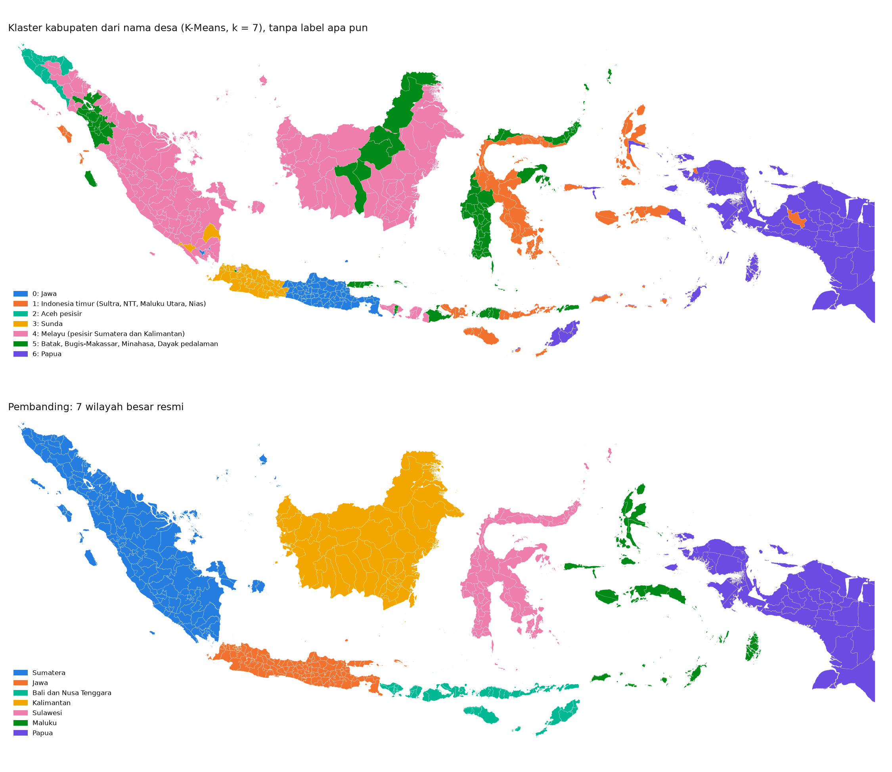

# Jejak Budaya dalam Nama

Menebak asal daerah sebuah desa hanya dari namanya. Proyek ini memakai 83.758 nama desa dan kelurahan di Indonesia untuk melihat seberapa banyak informasi budaya yang tersimpan dalam susunan huruf sebuah nama.

Dengan n-gram karakter, proyek ini melakukan tiga hal:

- **Klasifikasi**: menebak provinsi dan wilayah dari nama desa (Naive Bayes, Logistic Regression, SVM).
- **Klastering**: mengelompokkan 514 kabupaten berdasarkan kemiripan nama desanya, tanpa label (K-Means, Ward).
- **Generasi**: mengarang nama desa baru yang terdengar khas daerah tertentu (rantai Markov).

Coba langsung: **[jejaknama.streamlit.app](https://jejaknama.streamlit.app)**



## Hasil singkat

| Analisis                  | Hasil                                                                                                |
| ------------------------- | ---------------------------------------------------------------------------------------------------- |
| Tebak provinsi (38 kelas) | akurasi 40%, top-3 65% (tebakan acak 2,6%)                                                           |
| Tebak wilayah (7 kelas)   | akurasi 65%, top-3 90% (tebakan acak 14%)                                                            |
| Klastering kabupaten      | memisahkan Sunda dan Jawa, Aceh pesisir dan Gayo, tanah Batak dan pesisir Melayu, tanpa diberi label |
| Jejak transmigrasi        | desa di Lampung paling sering ditebak "Jawa", terutama Kota Metro (45%) dan Pringsewu (34%)          |
| Generator                 | 71% nama karangan ditebak classifier sesuai wilayah asalnya                                          |

## Menjalankan

Butuh Python 3.12 atau lebih baru.

```bash
git clone https://github.com/Adityamulyaf/data-mining-projects.git
cd data-mining-projects
python -m venv .venv
source .venv/bin/activate        # Windows: .venv\Scripts\activate
pip install -r requirements.txt
```

Dashboard lokal:

```bash
streamlit run app/streamlit_app.py
```

Dashboard berisi empat halaman: tebak nama desa, peta klaster, fakta menarik, serta generator nama dan kuis.

Notebook ada di `notebooks/` dan dijalankan berurutan:

| Notebook                    | Isi                                                 |
| --------------------------- | --------------------------------------------------- |
| `01_eda.ipynb`            | eksplorasi data                                     |
| `02_classification.ipynb` | perbandingan model klasifikasi                      |
| `03_clustering.ipynb`     | klastering kabupaten dan peta                       |
| `04_error_analysis.ipynb` | n-gram khas, analisis kesalahan, jejak transmigrasi |
| `05_generator.ipynb`      | generator nama desa dan bahan kuis                  |

## Struktur

```text
app/              dashboard Streamlit
data/raw/         data asli
data/processed/   data bersih dan hasil analisis
data/geo/         batas provinsi dan kabupaten (GeoJSON)
models/           model terlatih (joblib)
notebooks/        analisis
reports/          grafik dan tabel hasil
src/              kode bersama: pembersihan nama, konversi data, peta, generator
```

## Data

Kode dan nama wilayah sesuai Kepmendagri No 300.2.2-2138 Tahun 2025: 38 provinsi, 514 kabupaten/kota, 83.762 desa dan kelurahan.

Sumber:

- Kode dan nama wilayah: [wilayah.sql](https://github.com/cahyadsn/wilayah/blob/master/db/wilayah.sql)
- Batas provinsi dan kabupaten untuk peta: [wilayah_level_1_2.sql](https://github.com/cahyadsn/wilayah/blob/master/db/wilayah_level_1_2.sql)

Keduanya dari repositori [cahyadsn/wilayah](https://github.com/cahyadsn/wilayah) (lisensi MIT).

Untuk membuat ulang data dari sumber:

```bash
python src/convert_wilayah.py   # wilayah.sql menjadi CSV
python src/build_dataset.py     # pembersihan nama menjadi desa_clean.parquet
python src/convert_geo.py       # batas wilayah menjadi GeoJSON
```
