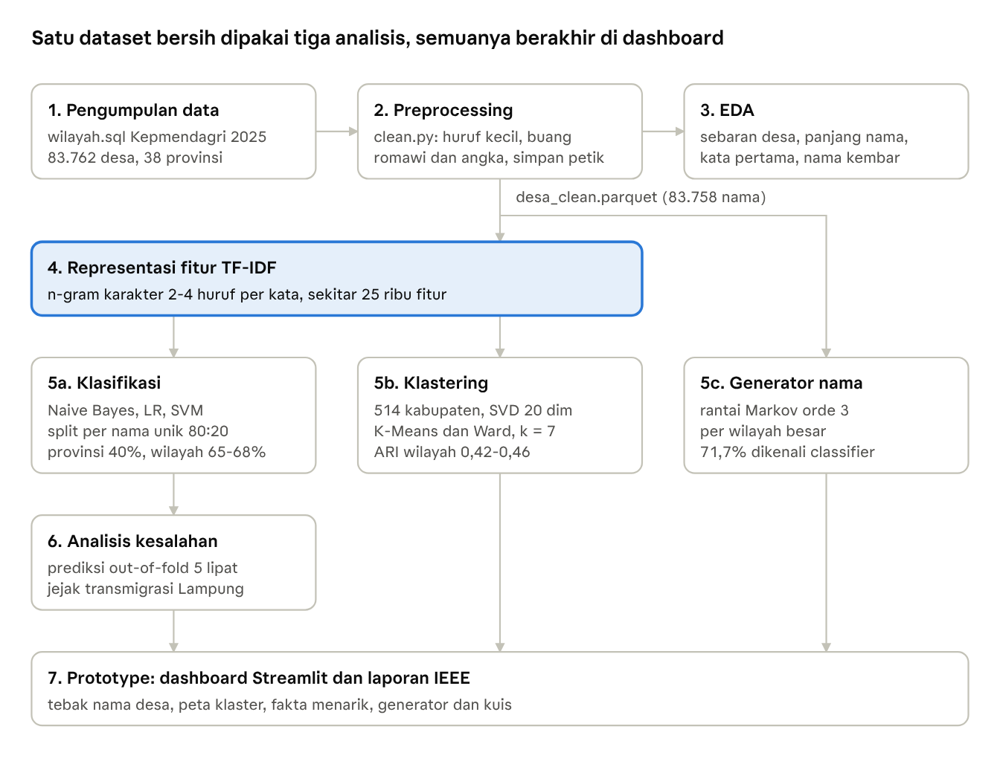

# Panduan Presentasi Proyek Data Mining

28 November 2026

## 1. Ringkasan proyek dalam 1 menit

Proyek ini menebak asal daerah sebuah desa hanya dari namanya, memakai 83.758 nama desa dan kelurahan di Indonesia. Hasilnya: provinsi tertebak benar sekitar 40% (tebakan acak cuma 2,6%), wilayah besar 65-68%.

Judul: **Jejak Budaya dalam Nama: Klasifikasi, Klastering, dan Generasi Nama Desa di Indonesia Berbasis N-gram Karakter.**

**Kalimat pembuka yang bisa dihafal:** "Nama desa di Indonesia tidak acak. Awalan Ci- hampir pasti Sunda, akhiran -rejo hampir pasti Jawa. Kami mengukur seberapa banyak jejak budaya itu tersimpan di susunan huruf sebuah nama."

| Pertanyaan | Jawaban singkat |
| --- | --- |
| Masalahnya apa? | Informasi budaya apa yang tersimpan di 83 ribu nama desa, dan seberapa banyak yang bisa diukur |
| Datanya apa? | Kode wilayah Kepmendagri 2025 (38 provinsi, 514 kabupaten/kota, 83.762 desa), dari repo GitHub cahyadsn/wilayah |
| Fiturnya apa? | TF-IDF n-gram karakter (potongan 2-4 huruf) |
| Metodenya apa? | Klasifikasi (Naive Bayes, Logistic Regression, SVM), klastering (K-Means, Ward), generator (rantai Markov) |
| Kuadran novelty? | Metode lama untuk masalah baru: metodenya klasik, tapi belum ada yang meneliti nama desa Indonesia |
| Produknya apa? | Dashboard Streamlit di jejaknama.streamlit.app, laporan format IEEE, model tersimpan |

**Lima temuan utama:**

1. Nama saja cukup untuk menebak provinsi 40% benar dan wilayah 65-68% benar; top-3 wilayah sekitar 90%.
2. Model menemukan sendiri ciri bahasa daerah: "\_ci" untuk Sunda, "blan" (blang) untuk Aceh, "\_aek" untuk Batak, "bont" (bonto) untuk Bugis-Makassar.
3. Tanpa label, klastering membelah Pulau Jawa jadi klaster Sunda dan klaster Jawa, mengikuti batas bahasa, bukan batas pulau.
4. Kesalahan model bermakna: desa di Lampung sering ditebak "Jawa" (Kota Metro 45,5%), jejak kolonisasi sejak 1905 dan transmigrasi.
5. Generator mengarang nama baru, dan 71,7% dikenali classifier sesuai wilayah asalnya.

## 2. Konsep dasar yang wajib dipahami

Cukup kuasai sepuluh istilah ini, maka 80% pertanyaan bisa dijawab. Penjelasannya sengaja pakai bahasa sehari-hari.

**N-gram karakter.** Potongan beberapa huruf berurutan dari sebuah kata. Contoh "rejo" dengan n=2: re, ej, jo. Proyek ini memakai panjang 2 sampai 4 huruf. Tanda \_ menandai batas kata, jadi "\_ci" artinya kata yang *diawali* ci, dan "rejo\_" artinya kata yang *diakhiri* rejo.

**TF-IDF.** Cara mengubah nama jadi deretan angka supaya bisa dibaca model. TF (term frequency) = seberapa sering potongan muncul di nama itu. IDF (inverse document frequency) = potongan yang langka di semua nama diberi bobot lebih besar, karena lebih khas. Potongan umum seperti "an" bobotnya kecil; potongan langka seperti "blan" bobotnya besar. Hasilnya sekitar 25 ribu fitur.

$$
w_{t,d} = \left(1 + \ln \mathrm{tf}_{t,d}\right) \cdot \left(\ln \frac{1 + N}{1 + \mathrm{df}_t} + 1\right)
$$

**Klasifikasi (supervised).** Model belajar dari contoh yang sudah ada labelnya (nama desa + provinsinya), lalu menebak label untuk nama baru.

- **Naive Bayes:** menghitung peluang tiap provinsi berdasarkan potongan huruf yang muncul, dengan anggapan tiap potongan saling bebas. Cepat (0,5 detik) dan jadi baseline klasik untuk teks.
- **Logistic Regression:** memberi bobot (koefisien) ke tiap potongan untuk tiap provinsi, lalu mengubah totalnya jadi probabilitas. Koefisiennya bisa dibaca: koefisien besar = potongan khas daerah itu.
- **SVM linear:** mencari garis batas pemisah antar kelas dengan jarak (margin) selebar mungkin. Biasanya kuat untuk fitur teks yang sangat banyak.

**Klastering (unsupervised).** Mengelompokkan data tanpa diberi label. Di proyek ini yang dikelompokkan adalah 514 kabupaten, berdasarkan rata-rata vektor nama desanya.

- **K-Means:** tentukan k titik pusat, masukkan tiap kabupaten ke pusat terdekat, geser pusat ke rata-rata anggotanya, ulangi sampai stabil.
- **Agglomerative Ward (hierarchical):** mulai dari tiap kabupaten sebagai kelompok sendiri, lalu gabungkan dua kelompok yang penggabungannya paling sedikit menambah keragaman, terus sampai tersisa k kelompok.

**Rantai Markov karakter.** Model peluang huruf berikutnya berdasarkan beberapa huruf sebelumnya. Contoh: setelah "rej" hampir selalu muncul "o". Dipakai untuk mengarang nama baru huruf demi huruf.

**Metrik evaluasi.**

| Metrik | Arti sederhana | Kenapa dipakai |
| --- | --- | --- |
| Accuracy | Persen tebakan yang benar | Paling mudah dipahami |
| Macro-F1 | Rata-rata F1 tiap kelas dengan bobot sama | Provinsi kecil (misal DKI, 267 desa) dihitung adil, tidak tenggelam oleh Jawa Tengah (8.563 desa) |
| Top-3 accuracy | Jawaban benar ada di 3 tebakan teratas | Wajar untuk kasus provinsi bertetangga yang budayanya mirip |
| Confusion matrix | Tabel kelas asli vs kelas tebakan | Melihat provinsi mana yang sering tertukar |
| Silhouette score | Seberapa rapat anggota satu klaster dan seberapa jauh dari klaster lain (-1 sampai 1) | Memilih jumlah klaster tanpa label |
| ARI (Adjusted Rand Index) | Kemiripan hasil klaster dengan pembagian resmi; 0 = acak, 1 = identik | Mengecek apakah klaster mirip wilayah budaya |

**Kebocoran data (data leakage).** Kalau nama yang sama (misal "Sidomulyo", ada di 98 desa) masuk data latih dan data uji sekaligus, model cukup menghafal, dan akurasinya terlihat tinggi palsu. Solusinya: data dibagi *per nama unik* dengan GroupShuffleSplit.

**Out-of-fold (OOF).** Data dibagi 5 bagian; tiap bagian ditebak oleh model yang dilatih dari 4 bagian lainnya. Jadi setiap desa dapat tebakan dari model yang belum pernah melihat namanya. Dipakai untuk analisis kesalahan.

**Class weight balanced.** Kelas kecil diberi bobot lebih besar saat latihan supaya model tidak cuma menebak provinsi besar.

## 3. Alur end-to-end proyek

Satu dataset bersih diubah menjadi fitur TF-IDF, lalu dipakai tiga analisis yang hasilnya dikumpulkan di dashboard.



TF-IDF (kotak berwarna) adalah fondasi bersama klasifikasi dan klastering; generator bekerja langsung dari nama bersih, lalu hasilnya diuji ke classifier.

1. **Pengumpulan data.** Unduh `wilayah.sql` (Kepmendagri 2025) dari repo cahyadsn/wilayah, ubah jadi CSV. Data sudah berlabel provinsi, jadi tidak perlu scraping atau pelabelan manual.
2. **Preprocessing.** Prinsipnya: buang yang administratif, pertahankan yang berbau budaya. Hasil: 83.758 baris, 62.769 nama unik, tanpa nilai kosong.
3. **EDA.** Jawa Tengah 8.563 desa vs DKI 267 (timpang 32 kali); median panjang nama 9 huruf; 63,8% nama satu kata; 4.250 nama dipakai di lebih dari satu provinsi ("Kampung Baru" ada di 24 provinsi).
4. **Fitur.** Nama dipotong jadi n-gram karakter 2-4 huruf, diberi bobot TF-IDF, dinormalisasi L2.
5. **Modeling.** (a) Klasifikasi provinsi dan wilayah dengan tiga model; (b) klastering kabupaten tanpa label; (c) generator nama baru.
6. **Evaluasi dan analisis kesalahan.** Accuracy, macro-F1, top-3, confusion matrix untuk klasifikasi; silhouette dan ARI untuk klastering; prediksi out-of-fold untuk mencari pola kesalahan.
7. **Prototype dan presentasi.** Dashboard Streamlit empat halaman dan laporan format IEEE.

## 4. Penjelasan file dan kode per tahap

Setiap tahap punya satu file utama; kalau ditanya "kodenya di mana?", tunjuk file di kolom kedua.

| Tahap | File | Apa yang dilakukan | Hasil |
| --- | --- | --- | --- |
| Konversi data | `src/convert_wilayah.py` | Mengubah `wilayah.sql` jadi CSV, satu baris per desa | `data/raw/wilayah_2025.csv` |
| Pembersihan | `src/clean.py` | Fungsi `clean_nama()`: huruf kecil, buang angka romawi dan angka, perluas singkatan Aceh, pertahankan tanda petik dan tanda hubung | dipakai semua notebook dan dashboard |
| Dataset bersih | `src/build_dataset.py` + `src/regions.py` | Menerapkan `clean_nama()` ke semua desa dan memetakan provinsi ke 7 wilayah besar | `data/processed/desa_clean.parquet` |
| EDA | `notebooks/01_eda.ipynb` | Jumlah desa per provinsi, panjang nama, kata pertama, nama kembar | grafik `reports/figures/01_*.png` |
| Klasifikasi | `notebooks/02_classification.ipynb` | Split per nama unik, TF-IDF, latih NB, LR, SVM untuk 2 target | `models/best_provinsi.joblib`, `models/best_wilayah.joblib`, `reports/metrics_baseline.csv` |
| Klastering | `notebooks/03_clustering.ipynb` + `src/peta.py` | Rata-rata vektor per kabupaten, SVD 20 komponen, K-Means dan Ward k=2..15, silhouette, ARI, peta | `data/processed/klaster_kabupaten.csv`, `reports/metrics_klastering.csv` |
| Analisis kesalahan | `notebooks/04_error_analysis.ipynb` | Prediksi out-of-fold, n-gram khas, confusion matrix, jejak transmigrasi, kandidat salah kode | `prediksi_oof.parquet`, `kandidat_salah_kode.csv`, `ngram_khas_*.csv` |
| Generator | `notebooks/05_generator.ipynb` + `src/generator.py` | Kelas `GeneratorNama(orde=3)`: latih per wilayah, karang nama, buang yang sudah ada, uji ke classifier | `nama_karangan.csv`, bahan dua kuis |
| Dashboard | `app/streamlit_app.py` | 4 halaman: tebak nama, peta klaster, fakta menarik, generator dan kuis | jejaknama.streamlit.app |
| Laporan | `reports/laporan.tex` | Laporan format IEEE conference | PDF laporan |

**Inti kode klasifikasi** (bentuk pipeline yang disimpan di `models/`):

```python
Pipeline([
    ("tfidf", TfidfVectorizer(analyzer="char_wb", ngram_range=(2, 4), min_df=2, sublinear_tf=True)),
    ("model", LogisticRegression(C=5, max_iter=2000, class_weight="balanced")),
])
# pembanding: MultinomialNB(alpha=0.1), LinearSVC(C=0.5, class_weight="balanced")
```

`char_wb` artinya potongan huruf diambil per kata dengan batas kata; `min_df=2` artinya potongan harus muncul di minimal dua nama; `sublinear_tf` adalah bagian "1 + ln tf" pada rumus TF-IDF.

**Cara menjalankan dashboard saat demo:** `streamlit run app/streamlit_app.py`, atau buka jejaknama.streamlit.app. Huruf dashboard dimuat dari Google Fonts, jadi siapkan internet; tanpa internet dashboard tetap jalan dengan huruf bawaan.

## 5. Hasil dan interpretasi

Semua model jauh di atas tebakan acak, perbedaan antar model kecil, dan yang paling menarik justru pola kesalahannya. Angka di bawah diambil dari `reports/` dan laporan.

### 5.1 Klasifikasi (data uji, dibagi per nama unik)

| Target | Model | Akurasi | Macro-F1 | Top-3 |
| --- | --- | --- | --- | --- |
| Provinsi (38) | Tebak kelas terbanyak | 0,100 | 0,005 | - |
| Provinsi (38) | Naive Bayes | **0,419** | 0,304 | **0,648** |
| Provinsi (38) | Logistic Regression | 0,401 | **0,330** | 0,642 |
| Provinsi (38) | SVM linear | 0,402 | 0,328 | 0,620 |
| Wilayah (7) | Tebak kelas terbanyak | 0,307 | 0,067 | - |
| Wilayah (7) | Naive Bayes | 0,654 | 0,541 | **0,899** |
| Wilayah (7) | Logistic Regression | 0,651 | 0,557 | 0,892 |
| Wilayah (7) | SVM linear | **0,678** | **0,571** | 0,895 |

Cara membacanya:

- Akurasi provinsi 40% itu sekitar **15 kali tebakan acak** (1/38 = 2,6%). Untuk wilayah, 65-68% vs acak 14%.
- Data latih 67.374 baris, data uji 16.384 baris (80:20 per nama unik).
- **Model akhir = Logistic Regression** untuk kedua target. Alasannya: selisih macro-F1 dengan model terbaik kurang dari 0,02, dan hanya LR yang sekaligus memberi probabilitas (untuk dashboard) dan koefisien yang bisa dibaca (untuk n-gram khas).
- Kenapa provinsi cuma 40%? Banyak provinsi hasil pemekaran dengan budaya sama: 29% desa DIY ditebak Jawa Tengah, 28,1% desa Banten ditebak Jawa Barat. Itu wajar, bukan kegagalan model.

### 5.2 N-gram paling khas (koefisien Logistic Regression)

| Daerah | N-gram khas | Catatan |
| --- | --- | --- |
| Sunda (Jawa Barat) | \_ci, eu | Ci dari kata Sunda *cai* (air) |
| Aceh | eu, ie, blan | 95% desa yang mengandung "blan" ada di Aceh |
| Batak (Sumatera Utara) | aek, lau | 100% desa yang mengandung "\_aek" ada di Sumut |
| Bugis-Makassar | pp, ll, kk, bont | Konsonan ganda, "bonto" |
| Lampung | way | |
| Minangkabau | koto | |
| Timor (NTT) | oe | |

### 5.3 Klastering kabupaten

| Metode (k=7) | Silhouette | ARI provinsi | ARI wilayah |
| --- | --- | --- | --- |
| K-Means (hasil utama) | **0,247** | 0,165 | 0,418 |
| Ward | 0,222 | **0,182** | **0,456** |

- **Kenapa k=7?** Silhouette tertinggi sebenarnya di k=13 (0,267), tapi selisihnya kecil. k=7 adalah puncak lokal pertama di kedua metode, masih bisa ditafsirkan satu per satu, dan sama dengan jumlah wilayah besar sehingga bisa dibandingkan langsung.
- **Kenapa silhouette rendah (<0,3)?** Nama desa berubah bertahap dari satu daerah ke tetangganya, tidak ada batas tajam. Ini temuan, bukan kesalahan.
- ARI 0,42-0,46 artinya klaster jauh lebih mirip wilayah resmi daripada acak, tapi tidak identik. Perbedaannya justru menarik.

Tujuh klaster yang terbentuk (nama diberi tim setelah membaca isinya):

| Klaster | Jumlah kabupaten | Isi utama | Contoh nama desa |
| --- | --- | --- | --- |
| Melayu | 183 | Pesisir Sumatera dan Kalimantan | mekar jaya, sukaraja |
| Batak, Bugis, Minahasa, Dayak | 80 | Sulsel, Sulut, Sumut | benteng, pardomuan, bonan dolok |
| Jawa | 72 | Jatim, Jateng, DIY, + Kota Metro dan Pringsewu (Lampung) | sidomulyo, sukorejo |
| Indonesia timur | 69 | Sultra, NTT, Maluku Utara, Nias | mataiwoi |
| Papua | 53 | Seluruh provinsi Papua | weri, trikora |
| Sunda | 42 | Jawa Barat, Banten | mekarsari, sukamanah |
| Aceh pesisir | 15 | Aceh (tanpa Gayo dan Alas) | gampong baro, blang dalam |

Keterbatasan: Bali tidak membentuk klaster sendiri; sebagian besar masuk klaster Melayu.

### 5.4 Jejak transmigrasi

- Di provinsi tujuan transmigrasi, **8,4%** desa ditebak sebagai provinsi di Jawa, hampir dua kali provinsi luar Jawa lain (4,3%).
- Paling kuat di **Lampung (16,3%)**: Kota Metro 45,5%, Pringsewu 33,6%. Kawasan ini adalah lokasi kolonisasi pertama Hindia Belanda di Gedong Tataan sejak 1905.
- Bukti tanpa model: 96 desa di luar Jawa memakai nama kabupaten di Jawa (Purworejo, Sukoharjo, Klaten), 41 di antaranya di Lampung.
- Catatan jujur: Bali juga sering ditebak Jawa (17,9%) padahal bukan tujuan transmigrasi; itu karena kedekatan bahasa Jawa-Bali.
- Kandidat salah kode wilayah hanya 62 desa (0,07%), dan setelah dicek sebagian besar nama pendek yang kebetulan mirip. Jadi data Kepmendagri 2025 tidak menunjukkan kesalahan kode yang jelas.

### 5.5 Generator nama

| Orde | Nama baru (%) | Dikenali classifier (%) |
| --- | --- | --- |
| 2 | 90,5 | 55,0 |
| 3 (dipilih) | 85,5 | 72,3 |
| 4 | 69,0 | 74,3 |

Orde 3 dipilih sebagai titik tengah: orde 2 kreatif tapi kurang khas, orde 4 khas tapi sering menyalin nama yang sudah ada. Dari 350 nama karangan (50 per wilayah), 71,7% dikenali sesuai wilayahnya. Contoh: Cikayung (Jawa), Lubuk Simodo (Sumatera), Lintai Hilir (Kalimantan), Wugunggunome (Papua).

## 6. Skrip presentasi dan pembagian peran

Presentasi mengikuti 7 tahap TBP dan dibagi ke 5 peran sesuai `PLAN.md`; isi nama anggota di kolom pertama. Durasi per bagian hanya usulan, sesuaikan dengan batas waktu dari dosen.

| Pembicara | Bagian | Durasi | Yang dibawakan | Gambar pendukung |
| --- | --- | --- | --- | --- |
| P5 Dashboard dan Laporan | Pembuka dan rumusan masalah | 2 menit | Kalimat pembuka (bagian 1), 5 pertanyaan penelitian, kuadran novelty, jawaban "kan bisa di-Google?" | - |
| P1 Data | Data dan preprocessing | 2 menit | Sumber data, aturan pembersihan, nama kembar, kenapa split per nama unik | `01_jumlah_desa.png`, `01_nama_kembar.png` |
| P2 Klasifikasi | Modeling dan evaluasi klasifikasi | 3 menit | TF-IDF n-gram, 3 model, tabel hasil, kenapa LR dipilih | `02_perbandingan_model.png` |
| P4 Analisis dan Generator | N-gram khas dan jejak transmigrasi | 3 menit | N-gram khas, confusion matrix, peta jejak Jawa, Kota Metro 45,5% | `laporan_ngram.png`, `laporan_jejak_jawa.png` |
| P3 Klastering dan Peta | Klastering | 2 menit | Cara K-Means dan Ward, pemilihan k, ARI, peta 7 klaster (Sunda vs Jawa) | `03_pemilihan_k.png`, `03_peta_klaster.png` |
| P4 Analisis dan Generator | Generator | 1 menit | Rantai Markov orde 3, 71,7% dikenali | `05_generator_dikenali.png` |
| P5 Dashboard dan Laporan | Demo dan kuis | 4 menit | Demo tebak nama, kuis Manusia vs Mesin, kuis Asli atau Palsu | dashboard langsung |
| P5 Dashboard dan Laporan | Penutup | 1 menit | Kesimpulan dan saran | - |

**Contoh narasi per bagian (bisa dibaca hampir apa adanya):**

1. **Pembuka.** "Pernah perhatikan, kenapa banyak desa di Jawa Barat diawali Ci-, dan di Jawa Tengah diakhiri -rejo? Kami ingin tahu: seberapa banyak jejak budaya tersimpan dalam sebuah nama desa, dan apakah mesin bisa membacanya."
2. **Data.** "Kami memakai data resmi Kepmendagri 2025: 83.762 desa. Setelah dibersihkan tersisa 83.758 nama, dengan 62.769 nama unik. Kami sengaja mempertahankan kata seperti gampong dan huta, karena itu justru petunjuk budaya."
3. **Klasifikasi.** "Nama dipotong menjadi potongan 2 sampai 4 huruf, lalu diberi bobot TF-IDF. Tiga model kami bandingkan. Provinsi tertebak 40%, atau 15 kali tebakan acak; wilayah besar sampai 68%."
4. **Analisis.** "Yang paling menarik justru salahnya model. Desa di Kota Metro, Lampung, hampir separuhnya ditebak Jawa. Ternyata di sana ada program kolonisasi sejak 1905."
5. **Klastering.** "Tanpa diberi label apa pun, kabupaten di Jawa terbelah dua: Sunda dan Jawa. Mesin menemukan batas bahasa sendiri."
6. **Generator.** "Kalau polanya sekuat itu, bisakah ditiru? Generator kami mengarang nama baru, dan 72% dikenali sesuai wilayahnya."
7. **Penutup.** "Nama desa bukan sekadar label administrasi; ia menyimpan bahasa, suku, bahkan sejarah perpindahan penduduk."

**Bahan kuis (kunci jawaban, jangan ditampilkan ke penonton):**

Kuis Manusia vs Mesin: Sumengko (Gresik, Jatim; mesin salah), Lampanah Baro (Aceh Besar; mesin benar), Wonua Morini (Konawe, Sultra; mesin benar), Wanasaba Daya (Lombok Timur, NTB; mesin salah), Ubiyau (Keerom, Papua; mesin salah). Skor mesin 2 dari 5.

Kuis Asli atau Palsu: asli = Bakung Raya, Cikarae Thoyyibah, Rante Pasele, Ile Gerong, Tegal Besar; palsu = Lamngai Lue, Karates Jaya, Kalo-oko Lapato, Wee Matakang, Long Raya.

**Checklist sebelum tampil:**

- [ ] Buka jejaknama.streamlit.app sejak awal (aplikasi Streamlit gratis bisa "tidur" dan butuh waktu bangun)
- [ ] Siapkan cadangan: jalankan `streamlit run app/streamlit_app.py` di laptop
- [ ] Coba 3 nama desa contoh yang hasilnya bagus, untuk jaga-jaga kalau nama dari penonton tebakannya salah
- [ ] Setiap anggota sudah membaca bagian 2 dan bagian 7
- [ ] Gladi lengkap sekali dengan timer

## 7. Bank pertanyaan dan jawaban

Pola menjawab: jawab langsung dalam satu kalimat, beri satu angka atau contoh, lalu berhenti. Kolom "Penjawab" adalah saran siapa yang paling siap.

### Tentang topik dan tujuan

| Pertanyaan | Jawaban yang disarankan | Penjawab |
| --- | --- | --- |
| Kan lokasi desa bisa dicari di Google? | Pertanyaan kami bukan "di mana desa X", tapi "informasi budaya apa yang tersimpan di nama desa". Model adalah alat untuk membedah pola. Selain itu model bisa menebak nama yang tidak ada di database (nama dusun, nama di arsip kolonial, desa pemekaran baru), dan menemukan jejak sejarah seperti transmigrasi. | Semua |
| Apa kegunaan praktisnya? | Tiga: menebak asal nama yang tidak ada di database, memeriksa kualitas data (desa yang namanya sangat tidak cocok dengan provinsinya ditandai sebagai kandidat salah kode), dan bahan kajian sejarah sosial dan bahasa. | P4 |
| Apa kebaruannya? | Kuadran metode lama untuk masalah baru. Metodenya klasik, tapi kami belum menemukan studi klasifikasi atau klastering nama desa Indonesia. Studi terdekat hanya identifikasi bahasa daerah dari kalimat utuh (Sujaini dan Putra 2024, NusaX). | P5 |
| Ada penelitian sejenis? | Ada untuk nama orang: Ambekar dkk. (KDD 2009) menebak etnis dari nama, Ye dkk. (CIKM 2017) NamePrism menebak kebangsaan. Untuk nama tempat: Fize dkk. (2021) memakai n-gram karakter untuk geocoding toponim. | P4 |

### Tentang data dan preprocessing

| Pertanyaan | Jawaban yang disarankan | Penjawab |
| --- | --- | --- |
| Datanya dari mana, bisa dipercaya? | Kode wilayah Kepmendagri No 300.2.2-2138 Tahun 2025 dari repo GitHub cahyadsn/wilayah (lisensi MIT). Jumlahnya cocok dengan angka resmi: 38 provinsi, 514 kabupaten, 83.762 desa. Kami sengaja tidak memakai sumber lain yang berasal dari OCR PDF karena berisiko salah ketik. | P1 |
| Kenapa 83.762 jadi 83.758? | 4 nama berupa singkatan huruf kapital (OP, MKCM, WKO, RD. PJKA) dibuang karena bukan nama sungguhan. | P1 |
| Kenapa kata seperti "gampong" atau "huta" tidak dibuang? | Justru itu petunjuk budaya: 82 desa berawalan Gampong semuanya di Aceh, 99 desa Huta semuanya di Sumatera Utara. | P1 |
| Kenapa angka romawi dibuang? | Angka romawi (sekitar 1.270 nama, misal "Sukamaju II") adalah penanda pemekaran administratif, bukan bagian budaya nama. | P1 |
| Kenapa tanda petik dipertahankan? | Tanda petik seperti "kandua'" dan "ba'u" adalah ciri bahasa di Sulawesi dan Aceh. | P1 |
| Data timpang, bagaimana menanganinya? | Jawa Tengah punya 8.563 desa, DKI hanya 267. Kami pakai class\_weight balanced pada LR dan SVM, dan melaporkan macro-F1 yang menilai semua provinsi setara. | P2 |

### Tentang metode klasifikasi

| Pertanyaan | Jawaban yang disarankan | Penjawab |
| --- | --- | --- |
| Kenapa n-gram karakter, bukan kata? | 63,8% nama desa hanya satu kata, dan ciri budaya sering ada di dalam kata (Karang-anyar, Suko-rejo). N-gram karakter menangkap awalan, akhiran, dan potongan khas, serta tetap bisa membaca nama yang belum pernah dilihat. | P2 |
| Kenapa n-gram 2 sampai 4? | Satu huruf terlalu umum, lebih dari 4 huruf terlalu jarang muncul sehingga model jadi menghafal. 2-4 menangkap pola seperti "ci", "eu", "rejo", "blan". | P2 |
| Apa bedanya TF-IDF dengan hitungan biasa? | TF-IDF menurunkan bobot potongan yang ada di hampir semua nama (misal "an") dan menaikkan bobot yang langka dan khas (misal "blan"). | P2 |
| Kenapa split per nama unik? | "Sidomulyo" ada di 98 desa. Kalau dibagi acak per baris, nama yang sama ada di data latih dan data uji, model cukup menghafal dan akurasi jadi palsu (data leakage). Dengan GroupShuffleSplit, tidak ada nama yang muncul di keduanya. | P2 |
| Kenapa memilih NB, LR, SVM? | NB baseline klasik teks yang cepat, LR bisa ditafsirkan dan memberi probabilitas, SVM linear biasanya terkuat untuk fitur teks berdimensi tinggi. Ketiganya mewakili pendekatan probabilistik, linear-probabilistik, dan margin. | P2 |
| Kenapa tidak Random Forest atau deep learning? | Random Forest berat untuk 25 ribu fitur jarang dan biasanya kalah dari model linear di teks. Deep learning (char-RNN) kami tulis sebagai saran pengembangan; fokus kami interpretasi, dan model linear memberi koefisien yang bisa dibaca. | P2 |
| NB akurasinya paling tinggi untuk provinsi, kenapa pilih LR? | Selisihnya kecil (0,419 vs 0,401), sedangkan macro-F1 LR justru tertinggi (0,330). LR juga satu-satunya yang memberi probabilitas dan koefisien sekaligus, dibutuhkan dashboard dan analisis n-gram. | P2 |
| Akurasi 40% kan rendah? | Ada 38 kelas, tebakan acak hanya 2,6%; 40% itu 15 kali lipat. Banyak provinsi berbudaya sama (DIY-Jateng, Banten-Jabar) yang memang mustahil dibedakan dari nama. Di tingkat wilayah akurasinya 68% dan top-3 90%. | P2 |
| Apa itu top-3 accuracy dan kenapa relevan? | Persen kasus jawaban benar ada di 3 tebakan teratas. Relevan karena provinsi bertetangga sering mirip, jadi tebakan "Jateng, DIY, Jatim" untuk desa DIY tetap informatif. | P2 |
| Sudah tuning hyperparameter? | Ya, parameter akhir: NB alpha=0,1; LR C=5; SVM C=0,5. | P2 |

### Tentang klastering

| Pertanyaan | Jawaban yang disarankan | Penjawab |
| --- | --- | --- |
| Apa yang dikelompokkan? | 514 kabupaten. Tiap kabupaten diwakili rata-rata vektor TF-IDF semua nama desanya, lalu diperkecil ke 20 dimensi dengan TruncatedSVD. | P3 |
| Kenapa pakai SVD? | Vektor asli sekitar 25 ribu dimensi; jarak di dimensi setinggi itu kurang bermakna dan perhitungannya berat. 20 komponen menyimpan pola utama. | P3 |
| Kenapa k=7, padahal silhouette tertinggi di k=13? | Selisihnya kecil (0,267 vs 0,247). k=7 puncak lokal pertama di kedua metode, bisa ditafsirkan per klaster, dan sama dengan jumlah wilayah besar sehingga bisa dibandingkan dengan ARI. | P3 |
| Silhouette 0,25 kan rendah? | Ya, dan itu temuan: nama desa berubah bertahap antar daerah tetangga, tidak ada batas tajam seperti garis provinsi. | P3 |
| Apa arti ARI 0,42? | Klaster jauh lebih mirip wilayah resmi daripada acak (0), tapi tidak identik (1). Perbedaannya bermakna: klaster mengikuti batas bahasa dan suku, misal Jawa terbelah Sunda dan Jawa. | P3 |
| K-Means vs Ward, mana lebih baik? | K-Means silhouette-nya lebih tinggi (0,247 vs 0,222) sehingga jadi hasil utama; Ward sedikit lebih mirip wilayah resmi (ARI 0,456). Polanya mirip. | P3 |
| Nama klaster dari mana? | Diberi tim setelah membaca isi tiap klaster (provinsi terbanyak, n-gram menonjol, nama tersering). Model tidak pernah melihat label. | P3 |

### Tentang analisis kesalahan dan generator

| Pertanyaan | Jawaban yang disarankan | Penjawab |
| --- | --- | --- |
| Bagaimana tahu itu jejak transmigrasi, bukan kebetulan? | Tiga bukti: angka di provinsi tujuan transmigrasi (8,4%) hampir dua kali provinsi lain (4,3%); puncaknya di Metro dan Pringsewu, lokasi kolonisasi 1905; dan ada 96 desa luar Jawa yang memakai nama kabupaten di Jawa, 41 di Lampung. | P4 |
| Kenapa pakai prediksi out-of-fold? | Model akhir sudah melihat semua desa, jadi tebakannya ke data itu tidak jujur. OOF memastikan tiap desa ditebak model yang belum pernah melihat namanya. | P4 |
| Bali juga sering ditebak Jawa, bagaimana? | Betul (17,9%), padahal Bali bukan tujuan transmigrasi. Itu karena kedekatan bahasa dan budaya Jawa-Bali. Kami sebutkan sebagai catatan di laporan. | P4 |
| Ditemukan kesalahan kode wilayah? | Hanya 62 kandidat (0,07%), dan setelah dicek sebagian besar nama pendek yang kebetulan mirip daerah lain. Jadi tidak ada tanda jelas kesalahan kode di data 2025. | P4 |
| Bagaimana generator bekerja? | Rantai Markov orde 3: dari semua nama di satu wilayah dihitung huruf apa yang biasanya muncul setelah tiap 3 huruf, lalu nama dibangun huruf demi huruf sampai tanda akhir. Nama yang sudah ada di data dibuang. | P4 |
| Kenapa orde 3? | Orde 2: 90,5% nama baru tapi hanya 55% dikenali. Orde 4: 74,3% dikenali tapi hanya 69% baru. Orde 3 titik tengah (85,5% baru, 72,3% dikenali). | P4 |
| 71,7% dikenali, berarti generator bagus? | Artinya ciri nama per daerah cukup kuat untuk ditiru. Tapi perlu dibaca hati-hati: generator memakai pola paling umum di wilayahnya, jadi wajar lebih mudah dikenali daripada nama asli. | P4 |

### Tentang keterbatasan

| Pertanyaan | Jawaban yang disarankan | Penjawab |
| --- | --- | --- |
| Apa keterbatasan penelitian ini? | Provinsi pemekaran berbudaya sama sulit dibedakan; pemilihan k sebagian pertimbangan praktis; Bali tidak membentuk klaster sendiri; dugaan soal desa transmigrasi baru yang bernama Indonesia umum belum diuji. | P5 |
| Apa saran pengembangannya? | Aturan asosiasi (Apriori/FP-Growth) pada kata penyusun nama, misal "sido" dengan "mulyo"; model jaringan saraf tingkat karakter; data GeoNames untuk menebak negara dari nama kota di seluruh dunia. | P5 |
| Kenapa Apriori tidak dikerjakan? | Keterbatasan waktu 5 hari; fokus kami ke klasifikasi, klastering, dan generator. Apriori jadi saran pengembangan. | P5 |

**Kalau ditanya sesuatu yang tidak tahu:** jawab jujur, "Itu belum kami uji, tapi dugaan kami ...", atau oper ke anggota yang memegang bagian itu. Jangan mengarang angka.
